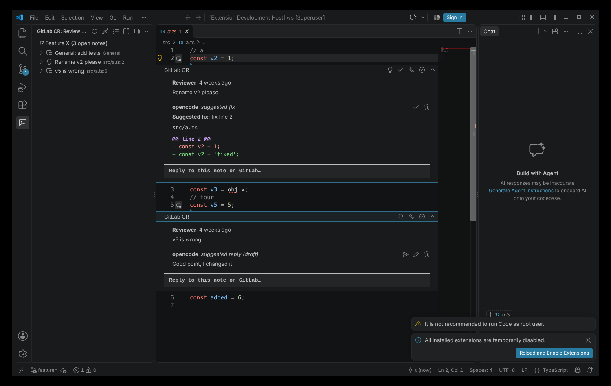
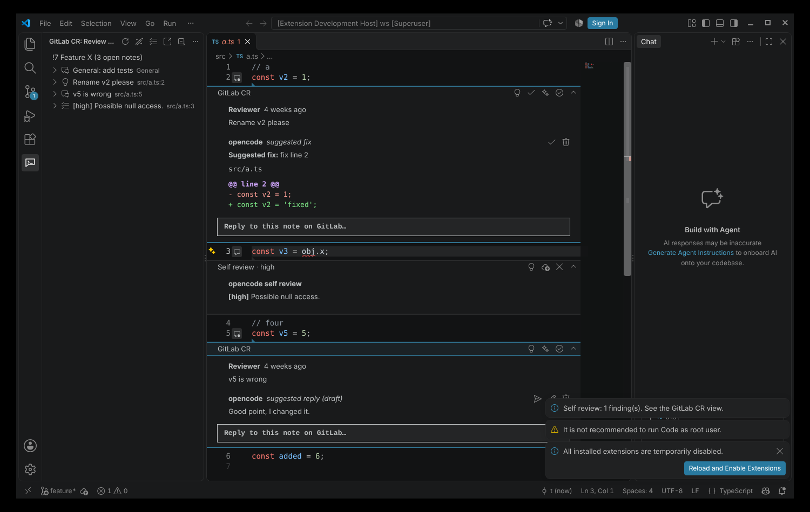

# GitLab CR + opencode (VS Code extension)

Shows the code review (CR) notes of your self-hosted GitLab merge request inside VS Code, and uses [opencode](https://opencode.ai) to suggest fixes and replies.

## How it looks

Notes on code lines show as comment threads directly under the line in the editor. The **GitLab CR** view in the activity bar lists all notes, including general notes that are not on a line.



Self review findings show the same way, with the label "Self review" and the severity:



## Features

| Button | Where | What it does |
| --- | --- | --- |
| **Refresh CR Notes** | GitLab CR view title | Finds the open merge request for the current branch and loads its discussions. Notes on code lines show as comment threads in the editor. General notes show in the view. |
| **Suggest Fix (opencode)** 💡 | Comment thread title, view item | Sends the note and the code around it to opencode. The suggested change shows as a diff comment in the thread. |
| **Apply Fix** ✓ | Suggestion comment, thread title, view item | Applies the suggested change to the file (you review and save). If the file changed after the suggestion, the extension finds the original code again; if it cannot, it tells you to ask for a new suggestion. |
| **Reply** | Reply box under each thread, view item | Posts your reply to the GitLab discussion. |
| **Suggest Reply (opencode)** ✨ | Thread title, view item | opencode writes a reply draft. Use **Edit**, **Send** or **Discard** on the draft. |
| **Fix All CR Notes** 🪄 | GitLab CR view title | Makes fixes for all open notes of the merge request (several in parallel) and uses the fixes that are already ready. Then it applies them in one edit. It skips notes whose fix you already applied or discarded. Fixes that overlap are not applied; the log shows them. |
| **Self Code Review** ☑ | GitLab CR view title | Sends your diff (merge base of the target branch to the working tree, including uncommitted changes) to opencode for a review. Findings show as threads. On each finding you can **Suggest Fix**, **Apply Fix**, **Post to Merge Request** or **Dismiss**. |
| **Resolve / Unresolve** | Thread title, view item context menu | Resolves the GitLab discussion. |

## Automatic mode

The extension works without a click in these cases:

1. **When VS Code opens** (if a token is saved), it loads the merge request of the current branch.
2. **When you check out another branch**, it loads the merge request of that branch. A commit on the same branch does not reload it.
3. **After each load**, opencode makes these in the background (status bar: "opencode: preparing CR suggestions"):
   - a suggested fix for each open note on a code line,
   - a reply draft for each open note.
   When it is done, a message tells you how many fixes and drafts are ready.

Nothing goes to your files or to GitLab until you click **Apply Fix** or **Send Reply**.

The automatic run skips a note when:
- it already has a suggestion,
- you wrote the last reply in the discussion,
- you already applied or discarded its fix (or discarded its draft).

Results are kept per workspace. Thus a restart or a switch back to a branch does not ask opencode again. When a reviewer adds a new reply to a discussion, that discussion gets new suggestions.

**Cost:** each new note can use two opencode requests (one fix, one reply). On a large merge request, set `gitlabCr.auto.suggestFixes` or `gitlabCr.auto.suggestReplies` to `false` if you do not want this.

## Requirements

- VS Code 1.85 or later.
- `git` on the `PATH`.
- [opencode](https://opencode.ai) installed and configured with a provider (`opencode auth login`). Test it with `opencode run "hello"`.
- A GitLab personal access token with the `api` scope.

## Setup

1. Install the extension (see *Build* below).
2. Open the repository. The `origin` remote must point to your GitLab server.
3. Run **GitLab CR: Set GitLab Access Token** and paste the token. It is kept in the VS Code secret storage. (The `GITLAB_TOKEN` environment variable also works.)
4. Check out the source branch of a merge request and click **Refresh** in the **GitLab CR** view.

The extension reads the GitLab URL and project path from the remote. Set them yourself when this does not work (for example an SSH host alias, a different HTTP port, or a relative URL root):

```jsonc
{
  "gitlabCr.baseUrl": "https://gitlab.example.com",   // add the path for a relative URL root, e.g. https://example.com/gitlab
  "gitlabCr.projectPath": "group/subgroup/project",    // or the numeric project ID
  "gitlabCr.strictSSL": true                           // false only for a self-signed certificate you trust
}
```

## opencode settings

| Setting | Default | Description |
| --- | --- | --- |
| `gitlabCr.opencode.path` | `opencode` | Path to the executable. |
| `gitlabCr.opencode.model` | (opencode default) | `provider/model`, for example `anthropic/<model-id>`. |
| `gitlabCr.opencode.agent` | `plan` | The `plan` agent can read the repository but cannot edit it. The extension makes the edits itself, only after you click **Apply**. |
| `gitlabCr.opencode.timeoutSeconds` | `300` | Limit for one request. |
| `gitlabCr.auto.refreshOnBranchChange` | `true` | Load the merge request of the new branch after a checkout. |
| `gitlabCr.auto.suggestFixes` | `true` | Make fix suggestions in the background after each load. |
| `gitlabCr.auto.suggestReplies` | `true` | Make reply drafts in the background after each load. |
| `gitlabCr.fixAll.concurrency` | `2` | Parallel opencode requests (Fix All and automatic mode). |
| `gitlabCr.fixAll.confirm` | `true` | Ask before **Fix All** applies the fixes. |
| `gitlabCr.selfReview.baseBranch` | (MR target, or `main`) | Branch for the self review diff. |
| `gitlabCr.selfReview.maxDiffKb` | `200` | Larger diffs are truncated. |

The extension runs `opencode run --format json --agent <agent> [--model <model>]` in the repository root and sends the prompt through stdin. The **GitLab CR** output channel shows each command and answer.

## Limits

- Line numbers come from the merge request diff. If your local file is different from the pushed version, a note can show on a different line.
- Notes on removed lines show on the same line number of the new file.
- The self review diff does not include untracked files. Use `git add -N <file>` to include a new file.
- **Post to Merge Request** puts the finding on the line only when that line is part of the pushed diff. If GitLab rejects the position, it posts a general note with the file and line.

## Build

```bash
npm install
npm run compile
npm test               # unit tests
npm run package       # makes gitlab-cr-opencode-0.1.0.vsix
code --install-extension gitlab-cr-opencode-0.1.0.vsix
```

To debug, open this folder in VS Code and press `F5` (**Run Extension**).
