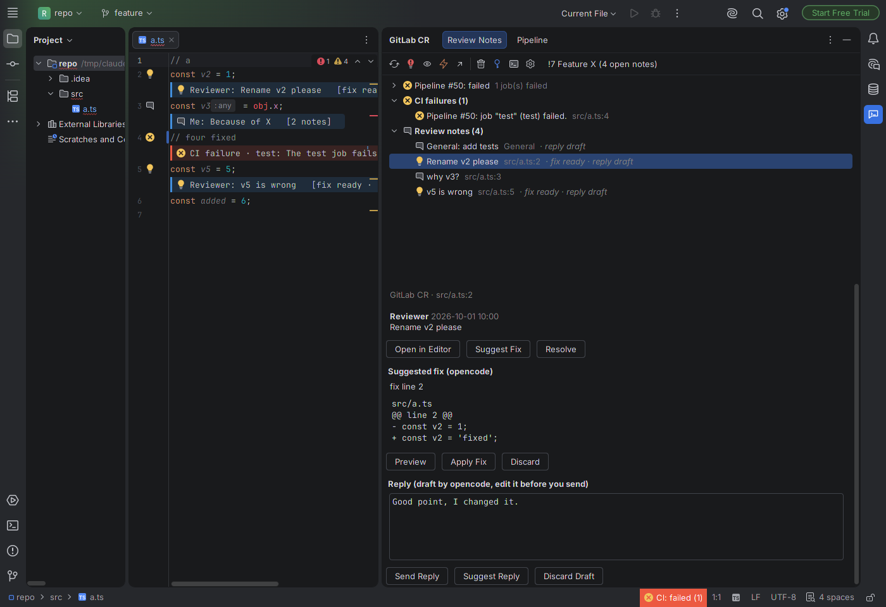
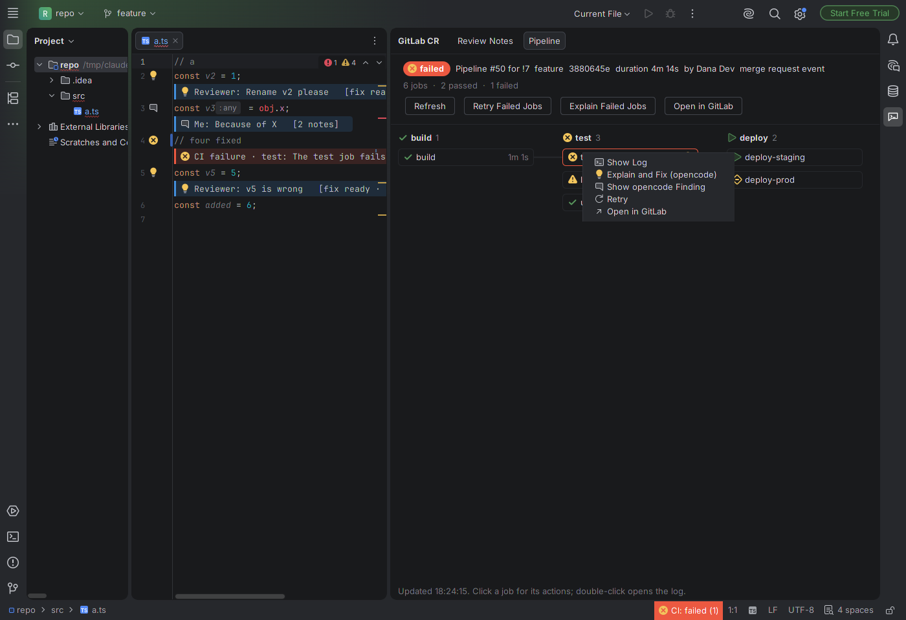
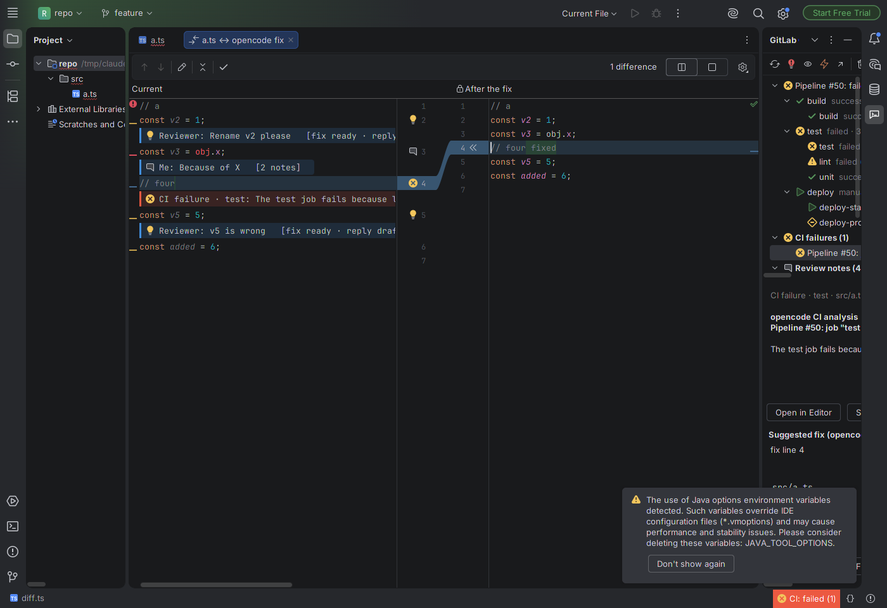
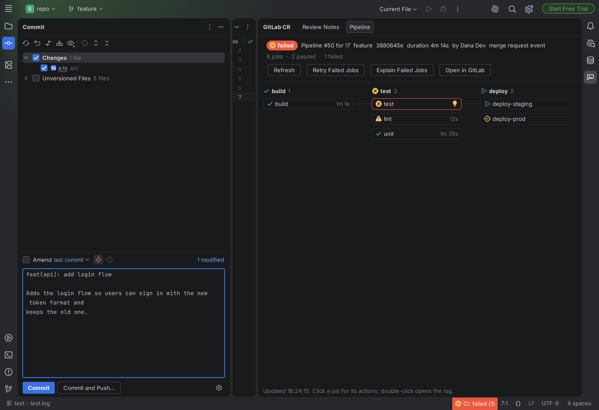

# GitLab CR + opencode for CLion

The CLion version of the VS Code extension in the parent folder. It shows the code review notes and the pipeline of your self-hosted GitLab merge request inside CLion, and uses [opencode](https://opencode.ai) to suggest fixes and replies, explain failed CI jobs, run a self code review, and write commit messages in your format.

The plugin uses only the IntelliJ Platform (no C++ API), so it also works in IntelliJ IDEA, PyCharm, GoLand, Rider and the other JetBrains IDEs. The JetBrains plugin verifier reports it compatible with CLion 2025.2 and 2026.2, with no use of deprecated, internal or experimental API.

## How it looks

| Where | What |
| --- | --- |
| **GitLab CR** tool window, tab **Review Notes** | The pipeline (stages and jobs), the CI failures, the review notes and the self review findings in a tree. The right side shows the selected note: the conversation, the opencode fix as a diff with **Preview**, **Apply Fix** and **Discard**, and a reply box with the opencode draft, **Send Reply**, **Suggest Reply** and **Discard Draft**. |
| Editor | A gutter icon on each line with a note (click: open the note), and a box under the line with the author, the note and what opencode prepared ("💡 fix ready", "✎ reply draft", "outdated"). |
| **GitLab CR** tool window, tab **Pipeline** | The pipeline graph as on the GitLab merge request page: one column per stage, one box per job with the status icon and the duration. Click a job for **Show Log**, **Explain and Fix**, **Retry**, **Run**, **Cancel**, **Open in GitLab**. Double-click opens the log. |
| Status bar | `CI: failed (1)`, red when the pipeline failed. Click: the pipeline graph. |
| Commit tool window | The ⚡ **Write Commit Message (opencode)** button in the commit message toolbar. |
| Tools menu | **GitLab CR** with all actions. |

The screenshots are from a real IDE with the plugin, against a mock GitLab server and a fake opencode (see *Tests*).

Notes in the editor and in the tool window, with the fix and the reply draft from opencode:



The pipeline graph, with the actions of a failed job:



**Preview** opens the IDE diff viewer. The ✓ button in its toolbar applies the fix:



The ⚡ button in the commit tool window writes the commit message for the checked files:



## Features

The features are the same as in the VS Code extension:

- Finds the open merge request of the current branch, loads its discussions, and moves the GitLab line numbers to your local code (`git diff <commit> -- <file>`). Notes whose line you changed show as outdated.
- Automatic mode: loads on project open, on branch checkout and every 5 minutes (only while the IDE has focus). After each load, opencode prepares a fix for each open note on a code line and a reply draft for each open note, in the background. Nothing goes to your files or to GitLab until you click **Apply Fix** or **Send Reply**.
- **Fix All CR Notes**: makes the missing fixes and applies all of them in one undoable command. Overlapping fixes are not applied.
- **Self Code Review**: sends your diff against the target branch to opencode. You can fix, post or dismiss each finding.
- **Pipeline**: status bar, graph, job logs in a read-only editor (colors and section markers removed), retry, run and cancel. When the pipeline fails, opencode reads the end of the log of each failed job and proposes a fix as a **CI failure** note.
- **Commit message**: the same fully configurable format (template with `{?name:...}` blocks, types, scopes, subject rules, body policy and style, wrap column, footer with `{issue}` from the branch and `{mr}`, language, rules, examples). The diff is the files that are checked in the commit tool window. The plugin checks the answer against the format and asks opencode one more time when it does not match.

## Install

```bash
cd clion
./gradlew buildPlugin          # makes build/distributions/gitlab-cr-opencode-clion-0.1.0.zip
```

In CLion: **Settings | Plugins | ⚙ | Install Plugin from Disk…** and select the zip. Restart CLion.

The first build downloads CLion (about 1.5 GB) for the compile classpath. It needs JDK 21; Gradle 9 comes with the wrapper. Other tasks:

| Task | What it does |
| --- | --- |
| `./gradlew runIde` | Starts CLion with the plugin (CLion asks for a license or a JetBrains account). |
| `./gradlew runIdea` | Starts IntelliJ IDEA with the plugin. It needs no license, so it is good for a quick try. |
| `./gradlew verifyPlugin` | Runs the JetBrains plugin verifier against CLion 2025.2 and 2026.2. |

## Setup

1. Open the repository. The `origin` remote must point to your GitLab server.
2. **Tools | GitLab CR | Set GitLab Access Token…**: a personal access token with the `api` scope. It is kept in the IDE password safe. The `GITLAB_TOKEN` environment variable also works.
3. Check out the source branch of a merge request. The notes load. Click **Refresh** in the tool window to load them again.

Settings are in **Settings | Tools | GitLab CR + opencode**:

- **Project settings** (GitLab URL and project, remote, self review, commit format) are kept in `.idea/gitlabCrProject.xml`. Commit this file to share the commit format with your team.
- **IDE settings** (opencode path, model, agent, timeout, automatic mode, pipeline) are kept per user.
- Suggestions and drafts are cached in the workspace file, so a restart does not ask opencode again.

GitLab requests use the IDE proxy settings and the IDE certificate store. A self-signed certificate that you accepted in the IDE works without turning off the TLS check.

## Tests

```bash
./gradlew test
```

- `CoreTest`: the pure logic (opencode output parsing, line mapping, edits, templates, commit format checks, log cleanup, CI rules).
- `PluginIntegrationTest`: runs the plugin in the headless CLion test platform with a mock GitLab server (`MockGitLab.kt`) and a fake opencode (`FakeOpencode.java`): load, line mapping, automatic suggestions, preview and apply, reply, pipeline, CI analysis, job actions and logs, self review, commit message, and the UI panels. It paints the panels to `build/screenshots`. The test platform replaces the IDE icons with blank ones, so those images have no icons; the images in `docs/` are from a real IDE.

## Differences from the VS Code version

- Notes show as a box under the line plus the details in the tool window. JetBrains has no public comment-thread API like VS Code, so replies are typed in the tool window, not in the editor.
- The pipeline graph is a native Swing panel, not a web view.
- The commit message describes the files that are checked in the commit window. VS Code uses the staged changes.

## Limits

- Not tested against a real GitLab server or a real opencode model. The tests and the screenshots use a mock and a fake.
- Not started in a licensed CLion: CLion asks for a license at the first start. The plugin ran in IntelliJ IDEA 2026.2 (same platform) and in the CLion test platform, and the verifier checked it against CLion.
- On Linux without a system keychain (`libsecret`), the IDE keeps the token in memory only, so you must set it again after a restart, or use `GITLAB_TOKEN`.
- After **Apply Fix** in the diff viewer, the viewer stays open and shows "No differences". Close it yourself.
- The graph connects stages, not `needs` relations. Child and downstream pipelines are not shown.
- Line numbers are moved with the files on disk; unsaved changes count only after a save and the next load.
